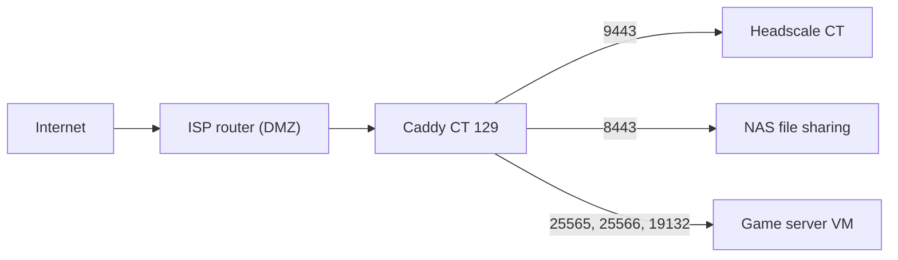

# Caddy
 
**Status:** production
**Runs on:** CT 129 on Migaloo (192.168.2.176)
**Last reviewed:** 2026-10-19
 
## What it is and why I use it
Caddy is the single entry point for every service I expose to the internet.
It works as an HTTPS reverse proxy and, with the `layer4` module, as a raw
TCP/UDP proxy for game servers.
 
My ISP blocks inbound ports 80 and 443, so the services listen on
non-standard ports (8443, 9443). The router forwards all inbound traffic to
this container (DMZ), which makes Caddy the only machine directly reachable
from outside.
 
I chose Caddy over other reverse proxies, such as Nginx Proxy Manager, which
I used before. The configuration is a short, readable file, there is no web
interface, and it is more lightweight. The trade-off is that it is not
"plug and play": for example, I had to add the layer4 module myself.
 
## Architecture
 

 
| Port | Type | Destination | Purpose |
|------|------|-------------|---------|
| 9443 | HTTPS reverse proxy | Headscale CT (:8443, web UI on :3000 under `/admin`) | VPN control server |
| 443 | Redirect | Port 9443 of the Headscale host | Convenience redirect |
| 8443 | HTTPS reverse proxy | NAS (:3410) | File sharing |
| 25565, 25566 | TCP (layer4) | Game server VM, same ports | Minecraft |
| 19132 | UDP (layer4) | Game server VM, same port | Minecraft Bedrock |
 
**How hostnames work with layer4:** the game server routes match on the
port only. Caddy never sees the hostname, because it is resolved by DNS
before the connection starts. Players can connect with `mc.example.com` (a
DNS-only record pointing to my public IP) or with the IP address, and reach
the same servers. Each server has its own port.
 
## Installation / configuration
1. Install Caddy from the package manager (version 2.11.4).
2. Add the `layer4` module by rebuilding Caddy with xcaddy (
   [Adding the layer4 module](#adding-the-layer4-module-xcaddy)).
3. Edit `/etc/caddy/Caddyfile` (sanitized copy below).
4. Validate and apply:
```bash
   caddy validate --config /etc/caddy/Caddyfile
   systemctl reload caddy
```
5. Check the service: `systemctl status caddy` (enabled and running).
Important files:
- `/etc/caddy/Caddyfile` - main configuration
- `/etc/caddy/certs/` - certificate and key used by the Headscale host (kept up to date by the sync script, see [Maintenance](#maintenance))
- `/var/log/caddy/access.log` - access log of the Headscale host
## Adding the layer4 module (xcaddy)
 
Caddy modules are compiled into the binary, so adding the `layer4` module
(needed for the game server TCP/UDP proxy) means building a custom Caddy.
`xcaddy` is the official tool for this: it downloads the Caddy source and
the requested modules and compiles them into a single binary.
 
**Requirements:** Go and `xcaddy`, installed as described in the xcaddy
documentation.
 
**Build:**
```bash
xcaddy build --with github.com/mholt/caddy-l4
```
To pin the Caddy version, put it right after `build`, for example
`xcaddy build v2.11.4 --with github.com/mholt/caddy-l4`. More modules can
be added with extra `--with` flags.
 
**Install:**
```bash
./caddy version
./caddy list-modules | grep layer4
cp /usr/bin/caddy /usr/bin/caddy.orig
systemctl stop caddy
cp ./caddy /usr/bin/caddy
systemctl start caddy
```
The first two commands check the new binary before it replaces the
packaged one. The backup copy (`caddy.orig`) allows an easy rollback.
 
**Updating:** a package update (`apt upgrade`) can overwrite the custom
binary. After every update, run `caddy list-modules | grep layer4`. If the
module is gone, build again with the same command.
 
## Configuration file
 
<details>
<summary>Sanitized Caddyfile</summary>
```caddyfile
{
	servers :9443 {
		protocols h1 h2
	}
	servers :443 {
		protocols h1 h2
	}
	layer4 {
		:25565 {
			route {
				proxy {
					upstream 192.168.2.194:25565
				}
			}
		}
		:25566 {
			route {
				proxy {
					upstream 192.168.2.194:25566
				}
			}
		}
		udp/:19132 {
			route {
				proxy {
					upstream udp/192.168.2.194:19132
				}
			}
		}
	}
}
 
headscale.example.com:443 {
	tls /etc/caddy/certs/fullchain.pem /etc/caddy/certs/key.pem
	redir https://headscale.example.com:9443{uri} permanent
}
 
headscale.example.com:9443 {
	tls /etc/caddy/certs/fullchain.pem /etc/caddy/certs/key.pem
	log {
		output file /var/log/caddy/access.log
		level INFO
	}
	handle /admin* {
		@denied not remote_ip 192.168.2.0/24 100.64.0.0/10
		respond @denied 403
		reverse_proxy 192.168.2.197:3000
	}
	handle {
		reverse_proxy 192.168.2.197:8443 {
			transport http {
				tls
				tls_insecure_skip_verify
			}
		}
	}
}
 
share.example.com:8443 {
	reverse_proxy 192.168.2.250:3410
}
```
 
</details>
## What the container listens on
Confirmed on 2026-10-19 with `ss -tlnp` and `ss -ulnp`:
 
| Scope | Ports | Process |
|-------|-------|---------|
| All interfaces (TCP) | 80, 443, 8443, 9443, 25565, 25566 | caddy |
| All interfaces (UDP) | 8443 (HTTP/3), 19132 | caddy |
| All interfaces (TCP) | 22 | sshd |
| Localhost only | 2019 (Caddy admin API), 25 (local mail) | caddy, postfix |
 
Port 21 is **not** listening in this container.
 
## Issues I ran into
| Symptom | Cause | Fix |
|---------|-------|-----|
| Port 21 (FTP) showed as open in an external nmap scan | Not this container (no listener on port 21). Source still under investigation (router, ISP or scan network) | _TODO_ |
| Repeated `layer4.handlers.proxy` errors in the journal | Under investigation (`journalctl -u caddy -l`) | _TODO_ |
| A full `nmap -p-` scan missed ports that were open | The scan used an aggressive rate and retry limit | Scan known ports directly, or repeat the full scan with default timing |
| The Headscale certificate in Caddy was older than the one issued by acme.sh | No process copied renewed certificates to this container | A script on the Proxmox host copies the certificate and reloads Caddy once a day |
| A `cloudflared` service restarted in a loop | Leftover from an abandoned attempt to expose a service I no longer use. No tunnel existed anymore | Removed the service |
 
## Backup and restore
- **What needs a backup:** `/etc/caddy/` (Caddyfile and certificates), `/var/lib/caddy/` and the container itself.
- **How to back it up:** _TODO: describe the Proxmox backup job._
- **How to restore:** restore the container, or copy the files back, then run `caddy validate` and `systemctl reload caddy`. The certificate files can be recreated by running the sync script. Tested on: _not yet_
## Maintenance
- **Updates:** `apt update && apt upgrade`. Afterwards, confirm the module is still there: `caddy list-modules | grep layer4`.
- **Logs:** `journalctl -u caddy -l` and `/var/log/caddy/access.log`.
### Certificates
The Headscale host uses a Let's Encrypt certificate:
 
1. **Issue and renewal:** `acme.sh` runs on the Headscale CT (CT 105) with a daily cron job and renews the certificate before it expires (DNS challenge through Cloudflare).
2. **Copy to Caddy:** a script on the Proxmox host
   ([`sync-headscale-cert.sh`](../scripts/sync-headscale-cert.sh)) runs every
   day at 18:30, after the `acme.sh` job. It pulls the certificate and key
   from CT 105, checks that the key matches the certificate, and, only if
   the certificate changed, pushes both files to `/etc/caddy/certs/` with
   the right owner and permissions and reloads Caddy.
3. **Logs:** the script is silent when nothing changed. When it updates the
   certificate it writes one line to the system log:
   `journalctl -t sync-headscale-cert`.
Check the certificate Caddy is serving:
```bash
echo | openssl s_client -connect localhost:9443 -servername headscale.example.com 2>/dev/null | openssl x509 -noout -dates
```
 
## Known limitations / future improvements
- [ ] Enable a default-deny firewall on this container and re-scan from outside
- [ ] Restrict SSH to the local network and use key-only authentication
- [ ] Replace `tls_insecure_skip_verify` with proper verification of the Headscale upstream
- [ ] Confirm how the certificate for the file-sharing host is obtained
- [ ] Check whether the local mail service (port 25, localhost) is needed
- [ ] Confirm the first automatic certificate renewal and copy (expected around 2026-11-22)
- [ ] Delete `/etc/caddy/certs.bak` once everything is confirmed
- [ ] Optional cleanup: remove the unused origin certificate files in `/var/lib/caddy/certs/`
## Change log
 
### 2026-10-19 - Certificate sync and cleanup
 
| # | Change | Why | How to verify | Rollback |
|---|--------|-----|---------------|----------|
| 1 | Added a certificate sync script on the Proxmox host (`/opt/scripts/sync-headscale-cert.sh`) and a daily cron job | The copy of the certificate in Caddy (valid 2026-08-28 to 2026-11-26) was older than the one issued by acme.sh (valid 2026-09-23 to 2026-12-22), and nothing updated it | `openssl x509 -in /etc/caddy/certs/fullchain.pem -noout -dates` shows the newer dates, and `s_client` on port 9443 serves them | Restore `/etc/caddy/certs.bak` and reload Caddy |
| 2 | Removed the unused `cloudflared` service | Leftover from an abandoned attempt; no tunnel existed and the service restarted in a loop | `systemctl status cloudflared` reports the unit as not found | None needed |
 
### 2026-10-19 - Caddyfile cleanup and hardening
Applied on 2026-10-19. Backup of the previous file: `/etc/caddy/Caddyfile.bak`.
 
| # | Change | Why | How to verify | Rollback |
|---|--------|-----|---------------|----------|
| 1 | Removed the `:8444` site block (game server web service) | The upstream (port 8100 on the game server VM) is no longer active, so the block only exposed a dead endpoint | `ss -tlnp` shows no listener on 8444 | Restore `Caddyfile.bak` |
| 2 | Kept the `mc.` hostname for game connections | Players use a name instead of an IP address, which also survives IP changes. It is a DNS-only record, and the layer4 routes do not need a site block | Connect to the game server using the hostname and port | None needed |
| 3 | Restricted Headscale `/admin` to the LAN (192.168.2.0/24) and the VPN range (100.64.0.0/10); everyone else gets a 403 | The admin interface should not be reachable from the whole internet | From outside: `/admin` returns 403. From the LAN: it opens | Remove the `@denied` and `respond` lines |
| 4 | Changed the Headscale log level from DEBUG to INFO | DEBUG produces large and noisy logs | `/var/log/caddy/access.log` grows more slowly | Set `level DEBUG` again |
| 5 | Removed the `/derp*` handler | It was identical to the default handler | The Headscale clients keep working | Restore `Caddyfile.bak` |
| 6 | Replaced the TCP route on 19132 with a UDP route | Bedrock uses UDP, so the TCP route could not carry Bedrock traffic | `ss -ulnp` shows caddy on 19132; a Bedrock client connects | Restore `Caddyfile.bak` |
 
**Considered and not applied:**
- `encode zstd gzip` on the file-sharing host: the service transfers large video files, so the benefit is small and I preferred not to change it.
- Splitting the Caddyfile into several files with `import`: the file is still short.
- Removing `tls_insecure_skip_verify`: needs a change on the Headscale side, so it stays on the improvements list.
- A `tls` directive for the file-sharing host: first I need to check in the logs how its certificate is obtained.
**Side effects to keep in mind:**
- The `/admin` restriction compares the client address Caddy sees. From outside the LAN, the admin page is only reachable through an address in the allowed ranges (for example, when Caddy itself is a node in the VPN).
- Port 8444 is no longer needed in the firewall or in the exposed ports list.
## Video
Link to the video (when available):
